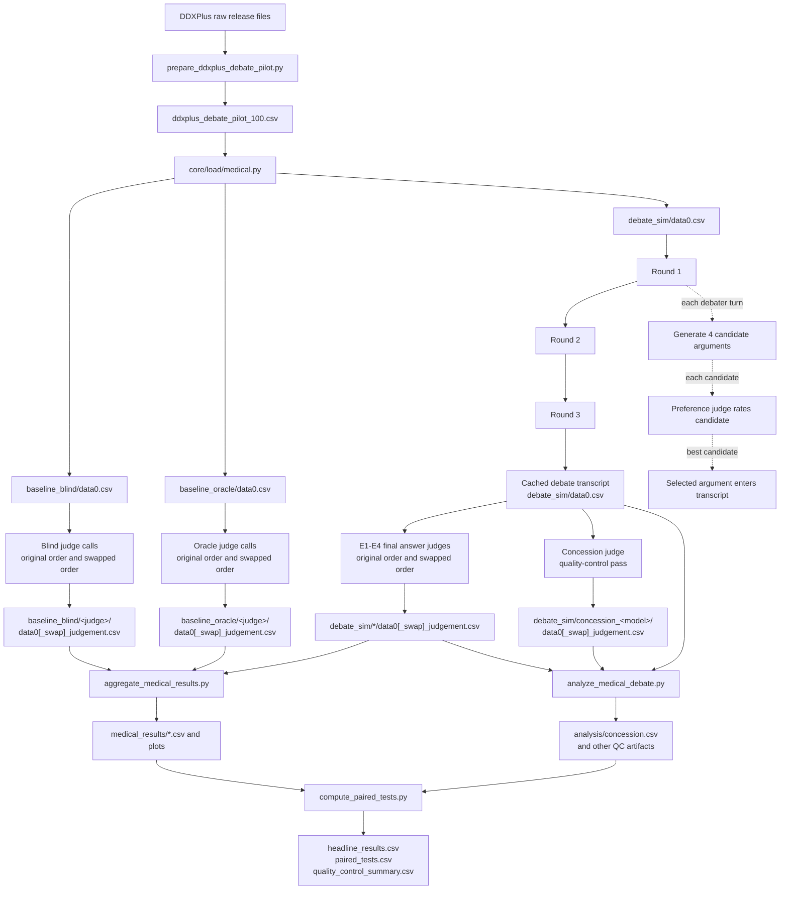

# Medical Debate

**Can AI debate help a weaker judge choose the right medical diagnosis?**


## Introduction

This repository is a work-in-progress research fork of
[`ucl-dark/llm_debate`](https://github.com/ucl-dark/llm_debate), the codebase
released with Khan et al. (2024), *Debating with More Persuasive LLMs Leads to
More Truthful Answers*. The original paper studied debate on hard reading
comprehension questions. This fork adapts the same broad oversight idea to
synthetic medical differential diagnosis.

> **Research use only.** This project uses synthetic patients to study AI
> oversight. It is not medical advice, a diagnostic system, or clinical
> decision support, and it must not be used to make decisions about real
> patients.

The core question is whether debate can make hidden evidence easier to judge.
Each case has two candidate diagnoses: the true DDXPlus pathology and a
plausible distractor from that case's differential diagnosis list. Two debaters
argue opposite sides while seeing the structured patient evidence. A judge then
chooses between the diagnoses, sometimes without seeing the evidence directly.

The motivation is future-facing. A clinician reviewing an AI-assisted diagnosis
may be surrounded by more information than they can realistically verify: a long
record, a differential diagnosis, prior history, medications, test results, and
model-generated reasoning arriving under time pressure. In that world, the
supervisor may not be weak in an absolute sense; they may simply be weaker than
the system on that task, or too overloaded to audit every detail from scratch.
This project uses a weaker model judge as a proxy for that future human
supervisor: capable enough to evaluate arguments, but not assumed to have the
time, context, or raw capability to reconstruct the answer alone.

The project is being developed as part of the BlueDot Impact Technical AI
Safety Sprint, with API spend supported by a BlueDot grant.

## Methodology

The experiment asks whether AI debate improves blind judging in synthetic
differential diagnosis from structured symptom and antecedent evidence. The
headline oversight setting is **E2: double asymmetry** — stronger debaters
see the patient evidence and argue both sides, while a weaker judge
evaluates the transcript without seeing the evidence. If E2 improves on a
blind baseline, debate is recovering some of the value of hidden evidence
without requiring the judge to inspect the full record.

The pilot uses **DDXPlus**, a public synthetic differential-diagnosis
dataset. The committed `data/ddxplus/ddxplus_debate_pilot_100.csv` is a
deliberately hard 100-case slice: adult cases, ≥20 evidence items each,
both the true pathology and the distractor with probability ≥ 0.05 and a
true-vs-distractor gap ≤ 0.10, picked round-robin across pathologies with
seed `20260504`. Full filtering rules and the regeneration command live in
[`docs/methodology.md`](docs/methodology.md); dataset source, licence, and local
rebuild instructions are in [`data/dataset_readme.md`](data/dataset_readme.md).

### Experimental arms

| Arm | Description | Debaters | Judge | Judge sees evidence? |
|---|---|---|---|---|
| B1 | Blind baseline | None | Weaker judge | No |
| B2 | Oracle baseline | None | Weaker judge | Yes |
| E1 | Information asymmetry | Frontier model | Same frontier model | No |
| E2 | Double asymmetry (headline) | Frontier model | Weaker model | No |
| E3 | Capability asymmetry | Frontier model | Weaker model | Yes |
| E4 | Full symmetry | Frontier model | Same frontier model | Yes |

The baselines define the floor and ceiling for **Performance Gap Recovered**:

```text
PGR = (debate_accuracy - blind_accuracy) / (oracle_accuracy - blind_accuracy)
```

Baselines and the debate arm use the **same judge model** in numerator and
denominator (Khan et al. convention): E2/E3 are anchored to weaker-judge
baselines, E1/E4 to frontier-judge baselines. Canonical baselines are
committed for both judges, per family.

### Model families

| Family | Frontier debaters / frontier judge | Weaker judge |
|---|---|---|
| OpenAI | `gpt-5.5` | `gpt-5.4-mini` |
| Anthropic | `claude-opus-4-6` | `claude-sonnet-4-6` |

E1 and E4 use the frontier model as final judge. E2 and E3 use the weaker
model as final judge. The concession quality-control judge uses `gpt-4o-mini`
for both families.

### Pipeline



Baselines are conceptually fixed reference constants once
`(judge_model, judge_prompt, dataset)` are pinned. Canonical 100-case
baselines for both families — covering **both the weaker and frontier
judges** so every debate arm has a same-judge floor and ceiling — are
committed at `data/canonical_baselines/` and re-used across debate runs by
default; flip "Recompute baselines" in the Streamlit sidebar to force a
fresh per-run pass over both judges.

### Debate generation


Each debate has three rounds. Both debaters see the structured patient
evidence; one is assigned the correct diagnosis and the other is assigned
the plausible distractor. Each turn uses **BoN=4**: the debater generates
four candidate arguments, a preference judge rates each against the
in-progress transcript, and the highest-rated candidate is written into the
transcript. The final answer judges run after the full transcript has been
generated.

### Bias controls

- **Swap-averaged accuracy.** Every case is judged in original and swapped
  A/B order; the two passes collapse into a per-case score of 0.0, 0.5,
  or 1.0. Position-biased cases score 0.5 by construction.
- **Position-bias breakdown.** `analysis/position_bias.csv` decomposes each
  arm into four `(orig_pick, swap_pick)` buckets and reports the resulting
  bias percentage.
- **Deterministic quote verification.** Cited spans are checked as exact
  normalised substrings of the patient evidence before judges see them;
  unverified spans are flagged as `<u_quote>`.
- **Quality-control judge.** A separate `gpt-4o-mini` pass flags debates
  where either side conceded or argued for the opposing diagnosis.
- **Verbosity, concession, and outcome diagnostics** are emitted alongside
  every run under `analysis/`.

For the detailed treatment of judge roles, sampling settings, and
output-directory schemas, see
[`docs/methodology.md`](docs/methodology.md).

## Results

**Status.** The OpenAI 100-case run is complete and curated below. The
Anthropic 100-case run is **still pending** — canonical Anthropic
baselines are committed, but the debate stage has not yet been executed
at n=100.

| Family | Status | Curated bundle |
|---|---|---|
| OpenAI (`gpt-5.5` / `gpt-5.4-mini`) | Complete (n=100) | [`results/openai_100/`](results/openai_100/) |
| Anthropic (`claude-opus-4-6` / `claude-sonnet-4-6`) | **Pending** | — |

The raw `exp/` folder remains gitignored because it contains large logs,
cache files, and full transcripts; each curated bundle in `results/`
contains the aggregate tables, plots, paired significance tests, and bias
diagnostics needed to evaluate the run.

The headline tables and plots are produced deterministically from a run's
cached judgement CSVs, while the curated folder also contains selected analysis
outputs and sanitized provenance metadata. The raw source run is not published:
`exp/` is gitignored because it contains full transcripts, API logs, caches, and
larger intermediate files. A fresh clone can inspect and validate the committed
bundle, but cannot reconstruct every file from source judgements without first
performing a new paid app run. Such a run is a replication, not a byte-for-byte
rebuild, because model generation is stochastic. Paired statistics —
case-paired bootstrap, sign-flip permutation, and Holm correction — are defined
once in `scripts/medical_stats.py`; see
[`docs/methodology.md`](docs/methodology.md#paired-statistics).

### OpenAI 100-case run

| Condition | Judge | Blind | Debate | Oracle | PGR |
|---|---:|---:|---:|---:|---:|
| E1 information asymmetry | `gpt-5.5` | 63.0% | 90.5% | 93.0% | 91.7% |
| E2 double asymmetry | `gpt-5.4-mini` | 60.5% | 84.0% | 84.0% | 100.0% |
| E3 capability asymmetry | `gpt-5.4-mini` | 60.5% | 87.5% | 84.0% | 114.9% |
| E4 full symmetry | `gpt-5.5` | 63.0% | 93.5% | 93.0% | 101.7% |


**Fig. 1. OpenAI 100-case accuracy by condition.** B1 is blind judging with no
patient evidence; B2 is oracle judging with the evidence shown directly. E1-E4
are the debate conditions. Bars are swap-averaged accuracies over 100 cases,
with weaker-judge conditions shown separately from frontier-judge conditions.
Higher is better; debate moves close to the same-judge oracle ceiling.


**Fig. 2. Performance Gap Recovered.** PGR measures how much of the gap between
blind and oracle judging is recovered by debate. 0% means no improvement over
blind judging; 100% means debate reaches the same-judge oracle baseline. Values
above 100% can occur in a finite sample when debate slightly exceeds the
measured oracle baseline.

All four debate arms substantially improve over their same-judge blind
baselines. The paired debate-vs-blind lifts are +23.5 to +30.5 percentage
points and remain significant after Holm correction across all eight paired
tests. Debate-vs-oracle differences are not significant in any arm, so the
careful interpretation is that the run does not detect a clear gap between
debate and the same-judge oracle ceiling.

The headline E2 setting, where a weaker judge evaluates stronger debaters
without seeing the evidence, reaches the weaker judge's oracle baseline:
84.0% debate accuracy versus 60.5% blind and 84.0% oracle. E3, where the
same weaker judge also sees the evidence, reaches 87.5%, slightly above the
weaker-judge oracle baseline in this sample. PGR confidence intervals are
wide because PGR is a ratio whose denominator is the blind-to-oracle gap
(only ~23.5pp for the weaker judge and ~30pp for the frontier judge): a
small, uncertain denominator inflates the ratio's CI even when both
endpoints are well estimated, so the most robust claim is the paired
debate-vs-blind lift rather than the exact PGR ordering.

### Bias and quality checks


**Fig. 3. Position-bias breakdown.** Each case is judged twice, once with the
correct diagnosis in position A and once in position B. Position-biased cases
are cases where the judge follows the answer letter rather than the diagnosis:
**A bias** means the judge picked A in both the original and swapped versions;
**B bias** means it picked B both times. Swap-averaged scoring already
discounts these cases to 0.5, but the plot shows where order sensitivity
remains, especially in E2.

The run passes the main quality checks: 100/100 debates were usable and
non-conceded, quote verification was 100% on both sides, and verbosity was
balanced at 134.2 words per correct-side turn versus 135.4 per incorrect-side
turn.

The main caveat is position bias. Swap-averaged scoring already discounts
order-sensitive cases to 0.5, but E2 still shows 18% position-biased cases.
That makes E2 directionally encouraging but less clean than E3, which has 9%
position bias. E1 and E4 are cleaner again at 5% and 3%.

### Limitations of the OpenAI run

The following limitations were identified in a post-hoc audit of the cached
run artefacts. The run was not repeated; the results above should be
interpreted in light of them.

#### Principal limitation: best-of-N argument selection was largely inoperative

The protocol specifies best-of-4 (BoN=4) selection: each debater samples four
candidate arguments per turn, a preference judge rates each candidate, and the
highest-rated candidate enters the transcript. In practice this selection
seldom took effect. The preference judge's output was capped at 64 completion
tokens, and `gpt-5.5` frequently exhausted that budget on hidden reasoning
before emitting an answer. The resulting empty responses were scored as
indeterminate (0.5). In total, 88% of the 2,400 candidate ratings were
indeterminate, and all four candidates tied on 516 of the 600 debater turns
(86%). Because ties resolve to the first candidate, the transcripts consist
predominantly of first-sampled arguments, and the condition studied is closer
to BoN=1 than to the specified BoN=4.

A post-hoc diagnostic on a single case reproduced the mechanism. With the
64-token cap, the preference prompt for the correct debater's argument
returned an answer in 6 of 6 trials, using 33–49 reasoning tokens. The prompt
for the incorrect debater's argument returned an empty response in 6 of 6
trials, having consumed the full allowance. With a 2,000-token cap, the latter
prompt returned an answer in 3 of 3 trials, using 512 reasoning tokens.

The failure was also asymmetric. Selection could discriminate between
candidates on 84 turns, of which 66 belonged to the correct debater and 18 to
the incorrect debater. In principle, this could advantage the truthful side.
However, among the 39 debates in which no selection occurred on any turn, E2
accuracy rose from 53.8% (blind) to 85.9% (debate), which suggests that the
observed gain does not depend on argument selection. This subset is small and
was not randomly assigned, so the comparison is indicative rather than
conclusive.

#### Minor limitations

- **Unmatched reasoning between oracle and debate judges.** The oracle
  baseline instructs the judge to output its answer only, whereas the debate
  judges are instructed to reason in writing before answering. Explicit
  reasoning may improve accuracy, so the oracle ceiling may be slightly
  understated. This bears on the claims that E2 matches the oracle and that
  E3 exceeds it, and on PGR values at or above 100%. It does not bear on the
  primary debate-versus-blind comparison. The effect is likely small, because
  the judge models can reason internally even when no written reasoning is
  requested. The blind baseline has the same mismatch.
- **Incomplete relabelling under A/B swapping.** The swapped judging pass
  exchanges the debater labels but not references to those labels within the
  argument text. In 55 of the 100 debates, a debater refers to its opponent by
  name (e.g. "Debater B's case proves ACS risk, not MI."). Under swapping,
  such statements appear to be self-directed. E2 swapped-pass accuracy was
  70.9% in affected debates and 82.2% in unaffected ones, although this
  comparison is uncontrolled. Because the inconsistency arises only in the
  swapped pass, any effect would bias accuracy downward rather than upward.

### Discussion

Khan et al. (2024), *Debating with More Persuasive LLMs Leads to More Truthful
Answers*, studied debate on hard reading-comprehension questions from QuALITY.
Their paper is linked as [`arXiv:2402.06782`](https://arxiv.org/abs/2402.06782).
Their central finding was that debate helped both non-expert LLM judges and
human judges: LLM debate reached roughly 76% accuracy versus a 48% naive
baseline, while human debate reached roughly 88% versus a 60% naive baseline.
They also report about 60% Performance Gap Recovered for debate.

This fork keeps the same broad oversight question but moves it into synthetic
medical differential diagnosis. Instead of asking whether a judge can answer a
reading-comprehension question without seeing the passage, this experiment asks
whether debate helps a judge choose the right diagnosis when the underlying
patient evidence is hidden or costly to inspect. The OpenAI 100-case result is
stronger than the Khan et al. LLM headline in PGR terms: the debate arms recover
roughly 92-115% of the blind-to-oracle gap. That should not be read as a direct
apples-to-apples win, because the task, models, domain, and sampling procedure
are different. The useful addition is narrower: on this hard DDXPlus slice,
same-judge debate nearly closes the gap between blind judging and evidence-aware
oracle judging, while exposing measurable residual risks such as position bias.

The pattern across conditions is more informative than any single headline
number. E1 shows that when a frontier judge does not see the patient evidence
directly, debate can still transmit enough of the hidden evidence to approach
the frontier judge's oracle baseline. E2 is the central oversight setting: a
weaker judge does not see the evidence, but stronger debaters do. Its result is
encouraging because the weaker judge reaches the same accuracy as its oracle
baseline, suggesting that debate can sometimes substitute for direct evidence
inspection. The caveat is that E2 also has the highest position bias, so it is
the most important arm to replicate and harden before treating the result as
robust. E3, where the weaker judge sees both the evidence and the debate, is
cleaner and slightly stronger; that suggests debate may help not only by
revealing hidden information, but also by organizing a large evidence record
into competing diagnostic arguments. E4 is the easiest condition — frontier
judge, frontier debaters, evidence visible — and functions more like a ceiling
check that the full system can recover the answer when capability and
information are both available.

The motivating clinical analogy is a busy doctor supervising AI systems in a
data-rich environment. A real patient record may include years of notes, labs,
medications, imaging reports, prior diagnoses, and generated model summaries.
Even a capable clinician may not have time to audit every relevant detail before
making a decision. Debate offers a possible amplification pattern: multiple AI
systems with access to the full EHR could argue for competing diagnoses,
surface the strongest evidence on each side, challenge weak reasoning, and let
the clinician judge a compressed adversarial transcript rather than search the
entire record from scratch. In that framing, debate is not replacing the doctor;
it is trying to make the doctor's limited attention go further.

This experiment is still a simplified proxy for that future. The cases are
synthetic, the task is two-choice differential diagnosis, and the judge is a
weaker model rather than a clinician. The patient evidence is structured
DDXPlus evidence rather than a messy real EHR. But the result is directionally
interesting because it tests the core bottleneck: can a less-informed or
time-limited overseer recover much of the value of hidden evidence by reading a
structured debate between better-informed systems? On this pilot, the answer is
yes, with the important qualification that bias controls and cross-family
replication matter.

That qualification is important. Recent work on free-form debate finds that
debate gains can be sensitive to task structure, model pairing, and training
conditions rather than automatically robust. See *Investigating the limits of
free-form debate as a scalable oversight strategy*
([OpenReview](https://openreview.net/forum?id=vRCGzuAhOM)). Our result is
encouraging evidence that debate can amplify a weaker judge in a
medical-diagnosis proxy task, but these gains should not be assumed to
generalize automatically across tasks, models, or training regimes.

The planned next comparison is the Anthropic 100-case run using Opus 4.6 and
Sonnet 4.6; canonical Anthropic baselines are already committed at
`data/canonical_baselines/anthropic/`.

### Anthropic 100-case run (pending)

The Anthropic 100-case run has not yet been executed. When it lands it
will be curated under `results/anthropic_100/` in the same shape as the
OpenAI bundle — `headline_results.csv`, `paired_tests.csv`,
`baselines_by_arm.csv`, the analysis subfolder, and the plot set — so the
cross-family comparison reads cleanly off the same column schema.

Until that run completes, treat the OpenAI numbers above as a
single-family pilot finding on the DDXPlus hard slice, not a model-family
robustness claim.

## How to run

### Requirements

- Python 3.11.
- OpenAI API access (required even for Anthropic-only runs, because the
  concession judge uses `gpt-4o-mini`).
- Anthropic API access if running the Anthropic family.
- The committed DDXPlus pilot CSV, included in this repository.

The OpenAI adapter is pinned to the legacy `openai==0.28.0` SDK in
`requirements.txt`; do not upgrade to `openai>=1.x` until
`core/llm_api/openai_llm.py` has been migrated.

### Install

```bash
python3.11 -m venv .venv
source .venv/bin/activate
python -m pip install --upgrade pip
python -m pip install -r requirements.txt
make hooks   # optional pre-commit hooks
make test    # local no-API regression suite
```

### Run the Streamlit app

The Streamlit frontend is the **only supported way to launch an experiment**.
The command below starts the local web app on the loopback interface; model
family, case count, baseline choice, API keys, confirmation, stopping, and
resume/extension are all handled in the UI.

```bash
.venv/bin/python -m streamlit run app/streamlit_app.py --server.address=127.0.0.1
```

Paste keys into the password fields in the sidebar. They are written only to a
permission-restricted, session-scoped temporary file for the duration of the
run; do not create a repository `SECRETS` file. The UI shows a planning estimate
and requires two clicks before paid provider calls begin. Start with 1–3 cases.
Canonical baselines are reused by default; the optional recomputation toggle
adds both cost and time.

Fresh **Run** clicks write outputs into a new
`exp/YYYY-MM-DD_HH-MM-SS_results/` folder. **Resume / extend** instead reuses the
most recent resumable folder for the selected model family, keeps its recorded
model choices and baseline source, and skips work already checkpointed as
complete. The former experiment shell wrappers have been removed, and direct
paid core-stage invocation is unsupported and blocked; the app owns validation,
cost confirmation, metadata, checkpointing, and safe resume behavior.

See [`docs/operating.md`](docs/operating.md) for the full app walkthrough,
cost/resume semantics, output layout, and the narrowly scoped no-API maintenance
tools used to inspect an existing run.

## Relationship to upstream

Focused research fork of `ucl-dark/llm_debate`. Upstream provides the
debate framework, rollouts, judge/debater abstractions, and scoring
patterns. This fork removes the QuALITY-era human-trial and tournament
tooling and adds the medical dataset loader, DDXPlus pilot preparation,
medical prompts, model-family configuration, OpenAI/Anthropic adapter
updates, swap judging, quote verification, concession analysis, result
aggregation, paired significance testing, the Streamlit frontend, and the
canonical-baselines layer.
Upstream paper: [`arXiv:2402.06782`](https://arxiv.org/abs/2402.06782).

## Acknowledgements

This work is part of the
[BlueDot Impact Technical AI Safety Sprint](https://bluedot.org/), a six-week
programme in which participants extend recent AI safety work into a small
original project. I am grateful to BlueDot for the programme structure,
mentorship, and grant funding for API credits.

## Citation

Base codebase and original debate result:

```bibtex
@misc{khan2024debating,
  title={Debating with More Persuasive LLMs Leads to More Truthful Answers},
  author={Akbir Khan and John Hughes and Dan Valentine and Laura Ruis and Kshitij Sachan and Ansh Radhakrishnan and Edward Grefenstette and Samuel R. Bowman and Tim Rocktäschel and Ethan Perez},
  year={2024},
  eprint={2402.06782},
  archivePrefix={arXiv},
  primaryClass={cs.AI}
}
```

DDXPlus dataset:

```bibtex
@inproceedings{tchango2022ddxplus,
  title={DDXPlus: A New Dataset For Automatic Medical Diagnosis},
  author={Tchango, Arsene Fansi and Goel, Rishab and Wen, Zhi and Martel, Julien and Ghosn, Joumana},
  booktitle={Advances in Neural Information Processing Systems Datasets and Benchmarks Track},
  year={2022}
}
```

This fork is licensed under the same MIT licence as upstream. See
[`LICENSE`](LICENSE).
