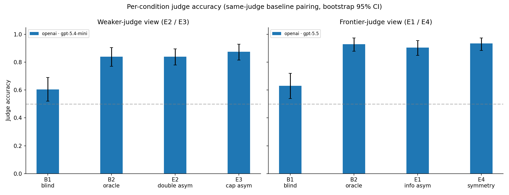
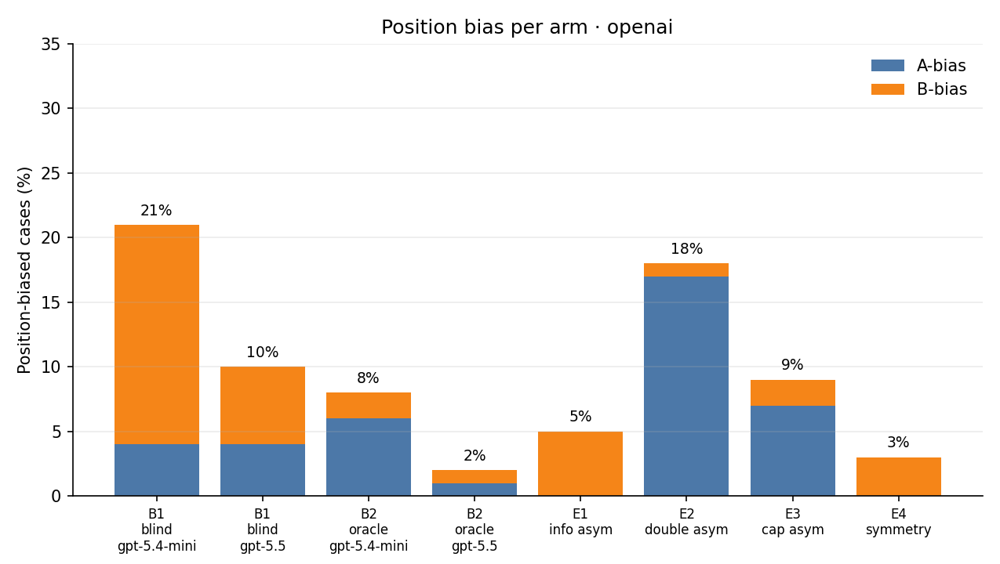

# OpenAI 100-Case Results

Curated result bundle for the 100-case OpenAI medical debate run. This folder is
intended to be tracked in git; the raw `exp/` run cache is intentionally
excluded because it contains full transcripts, logs, cache JSON, and larger
intermediate files.

Source run:

```text
exp/2026-05-20_19-57-54_results/openai
```

Models:

| Role | Model |
|---|---|
| Frontier debaters / frontier judge | `gpt-5.5` |
| Weaker judge | `gpt-5.4-mini` |
| Concession QC judge | `gpt-4o-mini` |

## Headline Results

Accuracies are swap-averaged over original and A/B-swapped judgements. PGR is
computed against the same-judge blind and oracle baselines:

```text
PGR = (debate_accuracy - blind_accuracy) / (oracle_accuracy - blind_accuracy)
```

| Condition | Judge | Blind | Debate | Oracle | PGR | PGR 95% CI |
|---|---:|---:|---:|---:|---:|---:|
| E1 info asymmetry | `gpt-5.5` | 63.0% | 90.5% | 93.0% | 91.7% | 77.4-109.1% |
| E2 double asymmetry | `gpt-5.4-mini` | 60.5% | 84.0% | 84.0% | 100.0% | 72.5-137.5% |
| E3 capability asymmetry | `gpt-5.4-mini` | 60.5% | 87.5% | 84.0% | 114.9% | 88.2-155.6% |
| E4 full symmetry | `gpt-5.5` | 63.0% | 93.5% | 93.0% | 101.7% | 87.3-120.0% |




## Statistical Tests

Primary tests compare each debate arm against its same-judge blind baseline.
All four debate arms remain significant after Holm correction across all eight
paired tests.

| Condition | Debate vs blind lift | Holm-adjusted p |
|---|---:|---:|
| E1 info asymmetry | +27.5 points | 0.000000034 |
| E2 double asymmetry | +23.5 points | 0.0000184 |
| E3 capability asymmetry | +27.0 points | 0.00000270 |
| E4 full symmetry | +30.5 points | 0.000000014 |

Debate-vs-oracle comparisons are not significant in any condition. That should
be read as "no detected difference from oracle" rather than proof of equality.
The full paired t-tests, Holm corrections, permutation checks, and bootstrap
confidence intervals are in [`paired_tests.csv`](paired_tests.csv).

### How the calculations work

The analysis is paired at the patient-case level. This matters because blind,
debate, and oracle performance are compared on the same 100 DDXPlus cases, not
as three unrelated percentages.

Each case is judged twice:

```text
original order: A = correct diagnosis, B = distractor
swapped order:  A = distractor, B = correct diagnosis
```

Those two judgements are collapsed into one swap-averaged per-case score:

| Original pass | Swapped pass | Interpretation | Case score |
|---|---|---|---:|
| correct | correct | judge chose the right diagnosis both times | 1.0 |
| wrong | wrong | judge chose the wrong diagnosis both times | 0.0 |
| correct | wrong | judge preferred position A | 0.5 |
| wrong | correct | judge preferred position B | 0.5 |

So every arm has a vector of 100 case scores:

```text
blind_scores  = [0.0, 0.5, 1.0, ...]
debate_scores = [0.0, 0.5, 1.0, ...]
oracle_scores = [0.0, 0.5, 1.0, ...]
```

Accuracy is just the mean of that vector. For example, E2 has debate accuracy
84.0%, meaning the 100 swap-averaged E2 case scores sum to 84.0.

PGR measures how much of the blind-to-oracle gap debate recovers:

```text
PGR = (debate_accuracy - blind_accuracy) / (oracle_accuracy - blind_accuracy)
```

For E2:

```text
blind  = 60.5%
debate = 84.0%
oracle = 84.0%

PGR = (84.0 - 60.5) / (84.0 - 60.5)
    = 23.5 / 23.5
    = 100.0%
```

For E3:

```text
blind  = 60.5%
debate = 87.5%
oracle = 84.0%

PGR = (87.5 - 60.5) / (84.0 - 60.5)
    = 27.0 / 23.5
    = 114.9%
```

PGR can exceed 100% when debate is above the oracle baseline in the observed
sample. That does not mean debate has a higher true ceiling than oracle; it
means the measured debate accuracy is above the measured same-judge oracle
accuracy on this 100-case sample.

### Paired t-tests

For each debate condition, two paired t-tests are run:

```text
1. debate vs blind
2. debate vs oracle
```

There are four debate conditions, so this gives eight tests total.

The paired t-test does not compare the headline percentages directly. It first
computes a per-case difference:

```text
diff_i = debate_score_i - blind_score_i
```

Then it asks whether the average of those 100 differences is clearly different
from zero. For E2 debate vs blind, the mean difference is:

```text
84.0% - 60.5% = +23.5 percentage points
```

But the paired test uses the 100 individual differences, not only that final
subtraction. This is why it is stronger than treating the two accuracies as
unpaired percentages: it knows whether debate and blind succeeded or failed on
the same cases.

The same logic is used for debate vs oracle:

```text
diff_i = debate_score_i - oracle_score_i
```

Here, a non-significant result means "we did not detect a clear difference from
oracle." It does not prove that debate and oracle are exactly equal.

### Multiple-testing correction

Because eight paired t-tests are run, the raw p-values are not the whole story.
If many tests are run at once, at least one can look significant by chance.

This bundle reports Holm-adjusted p-values in [`paired_tests.csv`](paired_tests.csv):

```text
holm_p_all_8_tests
```

Holm correction is a multiple-testing correction. It is less blunt than simple
Bonferroni, but it controls the family-wise error rate across the set of tests.
The public headline claim uses the stricter column that corrects across all
eight tests.

The file also includes:

```text
holm_p_within_4_tests
```

That column corrects within each family of four tests separately:

```text
four debate-vs-blind tests
four debate-vs-oracle tests
```

The all-eight correction is the more conservative one to cite for the main
result.

### Bootstrap confidence bounds

The confidence intervals in [`headline_results.csv`](headline_results.csv) and
[`paired_tests.csv`](paired_tests.csv) are paired bootstrap intervals.

No models are rerun. The bootstrap only resamples the existing 100 cases.

One bootstrap sample is made by drawing 100 cases with replacement from the
existing case list. When a case is drawn, its blind, debate, and oracle scores
are drawn together, preserving the pairing:

```text
case_017 -> blind score, debate score, oracle score
case_042 -> blind score, debate score, oracle score
case_017 -> blind score, debate score, oracle score again
...
```

For each bootstrap sample, the analysis recomputes:

```text
blind accuracy
debate accuracy
oracle accuracy
debate - blind
debate - oracle
PGR
```

This was repeated 20,000 times. The 95% confidence interval is the 2.5th to
97.5th percentile of those bootstrap results.

This is especially useful for PGR because PGR is a ratio:

```text
(debate - blind) / (oracle - blind)
```

Ratios can have awkward uncertainty, especially when the denominator is not
large. The bootstrap gives a more direct uncertainty estimate than trying to
use a simple normal approximation for the ratio.

### Permutation checks

The score differences are discrete:

```text
-1.0, -0.5, 0.0, +0.5, +1.0
```

That means the paired differences are not normally distributed. Paired t-tests
are usually fairly robust at n=100, but the bundle also reports a paired
permutation test:

```text
paired_permutation_p_two_sided
```

The permutation test asks: if debate had no real advantage on a case, what
would happen if the sign of each nonzero paired difference were randomly
flipped many times? It then checks how often the shuffled data produce an
average difference at least as large as the observed one.

This is a robustness check that relies less on normality. In this run, the
permutation checks tell the same story as the paired t-tests: debate-vs-blind
is strongly positive in all four conditions, while debate-vs-oracle does not
show a clear difference.

## Bias And Quality Controls



The main caution is position bias in E2: 18% of E2 cases were order-sensitive
after A/B swapping. The swap-averaged headline accuracy already scores those
cases as 0.5, but the bias rate means E2 should be interpreted with more care
than E3. Position bias was lower in E1 (5%), E3 (9%), and E4 (3%).

Other quality checks were clean:

| Check | Result |
|---|---:|
| Usable non-conceded debates | 100 / 100 |
| Conceded debates | 0 / 100 |
| Verified quotes, correct side | 1523 / 1523 |
| Verified quotes, incorrect side | 1401 / 1401 |
| Avg. words per turn, correct side | 134.2 |
| Avg. words per turn, incorrect side | 135.4 |

The full QC tables live under [`analysis/`](analysis/), with a compact rollup in
[`quality_control_summary.csv`](quality_control_summary.csv).

## File Guide

| File | Purpose |
|---|---|
| [`headline_results.csv`](headline_results.csv) | Main accuracy, same-judge baselines, PGR, and paired bootstrap CIs. |
| [`paired_tests.csv`](paired_tests.csv) | Paired t-tests, Holm-adjusted p-values, paired permutation checks, and paired bootstrap CIs. |
| [`accuracy_by_condition.csv`](accuracy_by_condition.csv) | Aggregated debate accuracy table used by the plot script. |
| [`baselines_by_arm.csv`](baselines_by_arm.csv) | Same-judge B1/B2 baseline accuracies. |
| [`pgr_by_condition.csv`](pgr_by_condition.csv) | PGR table emitted by the aggregate script. |
| [`per_case_lift.csv`](per_case_lift.csv) | Per-case debate-vs-blind lift table. |
| [`analysis/position_bias.csv`](analysis/position_bias.csv) | A/B swap position-bias breakdown for debates and baselines. |
| [`analysis/quote_verification.csv`](analysis/quote_verification.csv) | Per-case quote verification counts. |
| [`analysis/verbosity.csv`](analysis/verbosity.csv) | Per-case, per-round word counts. |
| [`run_metadata.json`](run_metadata.json) | Sanitised run metadata for this curated bundle. |
