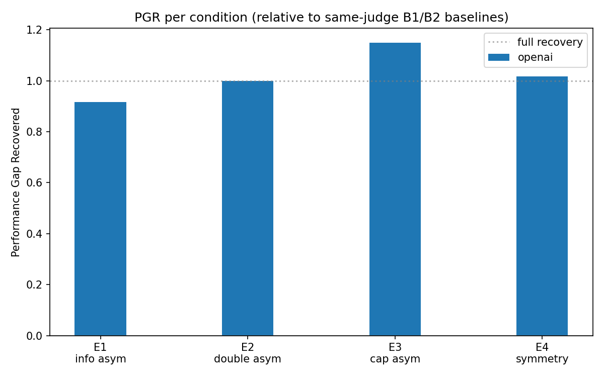
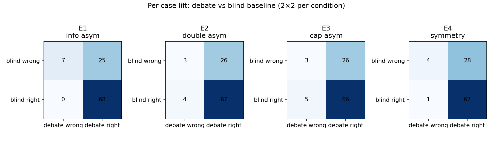
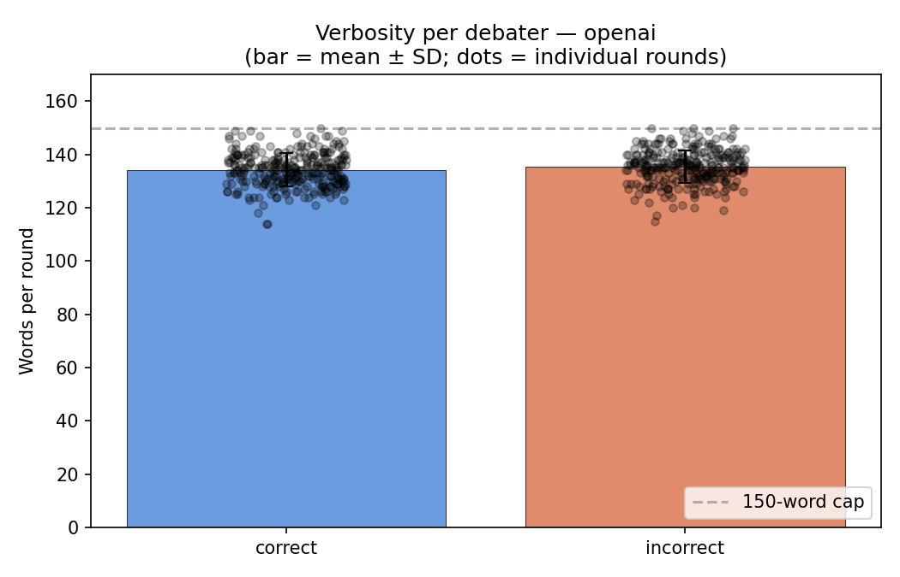
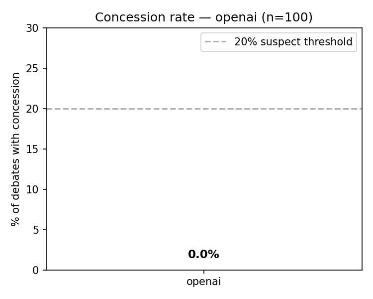
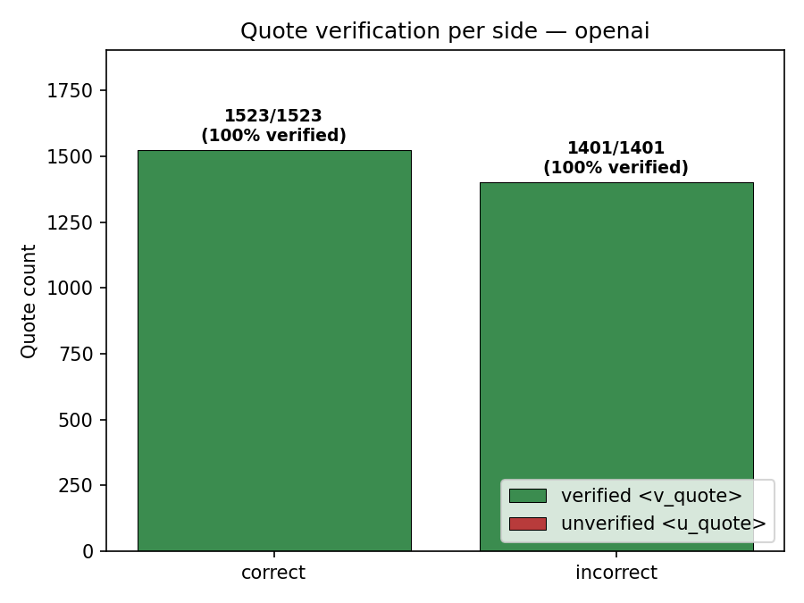
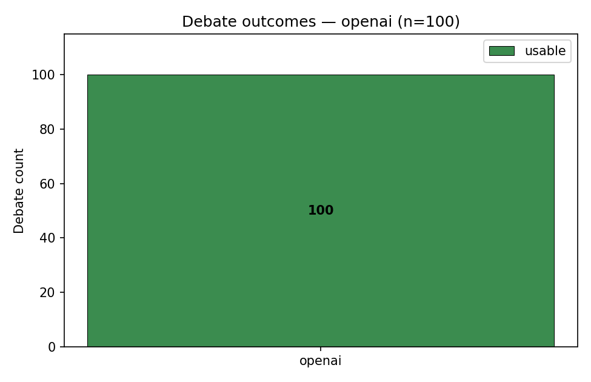

# OpenAI 100-Case Results

Curated result bundle for the 100-case OpenAI medical debate run. This folder is
intended to be tracked in git; the raw `exp/` run cache is intentionally
excluded because it contains full transcripts, logs, cache JSON, and larger
intermediate files.

Source run:

```text
exp/2026-05-20_19-57-54_results/openai
```

Models:

| Role | Model |
|---|---|
| Frontier debaters / frontier judge | `gpt-5.5` |
| Weaker judge | `gpt-5.4-mini` |
| Concession QC judge | `gpt-4o-mini` |

## Headline Results

Accuracies are swap-averaged over original and A/B-swapped judgements. PGR is
computed against the same-judge blind and oracle baselines:

```text
PGR = (debate_accuracy - blind_accuracy) / (oracle_accuracy - blind_accuracy)
```

| Condition | Judge | Blind | Debate | Oracle | PGR | PGR 95% CI |
|---|---:|---:|---:|---:|---:|---:|
| E1 info asymmetry | `gpt-5.5` | 63.0% | 90.5% | 93.0% | 91.7% | 77.5-108.5% |
| E2 double asymmetry | `gpt-5.4-mini` | 60.5% | 84.0% | 84.0% | 100.0% | 72.9-137.0% |
| E3 capability asymmetry | `gpt-5.4-mini` | 60.5% | 87.5% | 84.0% | 114.9% | 88.1-155.0% |
| E4 full symmetry | `gpt-5.5` | 63.0% | 93.5% | 93.0% | 101.7% | 87.1-120.0% |

Every CSV in this folder is regenerated by script from the cached judgement
CSVs — nothing here is assembled by hand. To reproduce it:

```bash
python scripts/aggregate_medical_results.py exp/<run>/openai \
    --baselines-dir data/canonical_baselines --out-dir results/openai_100
python scripts/compute_paired_tests.py     exp/<run>/openai \
    --baselines-dir data/canonical_baselines --out-dir results/openai_100
```

Both read the run's cached judgement CSVs under `exp/`, which is gitignored.
A fresh clone has the canonical baselines but not those judgements, so
reproducing this bundle from a clone means running the debate stage first —
the analysis layer is free, the transcripts that feed it are not.


**Fig. 1. Accuracy by condition.** Each bar is the percentage of cases where
the judge chose the correct diagnosis after swap-averaging original and
A/B-swapped judgements. B1 is the blind baseline, where the judge sees only the
two diagnoses and not the patient evidence. B2 is the oracle baseline, where
the judge sees the patient evidence directly. E1-E4 are the debate conditions.
The left panel uses the weaker judge (`gpt-5.4-mini`) for B1/B2/E2/E3; the
right panel uses the frontier judge (`gpt-5.5`) for B1/B2/E1/E4. Higher is
better. The main takeaway is that debate moves accuracy close to the
same-judge oracle ceiling.



**Fig. 2. Performance Gap Recovered (PGR).** PGR asks how much of the gap
between blind judging and oracle judging is recovered by debate. A value of
0% would mean debate performs no better than blind judging. A value of 100%
would mean debate reaches the oracle baseline. Values above 100% can happen in
a finite sample when debate slightly outperforms the measured oracle baseline.
The main takeaway is that all four OpenAI debate arms recover most or all of
the blind-to-oracle gap.



**Fig. 3. Per-case lift from blind judging to debate.** Each small heatmap
compares the same cases under the blind baseline and under debate. The most
important cell is "blind wrong / debate right": those are cases where debate
rescued a case the blind judge missed. The "blind right / debate wrong" cell is
the opposite: cases where debate hurt performance. This figure helps show that
the aggregate accuracy gains are made up of concrete case-level flips, not just
a change in overall percentages.

## Statistical Tests

Primary tests compare each debate arm against its same-judge blind baseline.
All four debate arms remain significant after Holm correction across all eight
paired tests, on both the permutation test and the t-test.

| Condition | Debate vs blind lift | Holm-adj. permutation p | Holm-adj. t-test p |
|---|---:|---:|---:|
| E1 info asymmetry | +27.5 points | 0.00004 | 0.000000034 |
| E2 double asymmetry | +23.5 points | 0.00005 | 0.0000184 |
| E3 capability asymmetry | +27.0 points | 0.00004 | 0.00000270 |
| E4 full symmetry | +30.5 points | 0.00004 | 0.000000014 |

The permutation column is the one to cite: it assumes nothing about normality,
which matters because the per-case differences are discrete. Its values sit at
the resolution floor of a 200,000-replicate permutation test rather than
indicating a weaker effect.

Debate-vs-oracle comparisons are not significant in any condition. That should
be read as "no detected difference from oracle" rather than proof of equality.
The full paired t-tests, Holm corrections, permutation checks, and bootstrap
confidence intervals are in [`paired_tests.csv`](paired_tests.csv).

### How the calculations work

The analysis is paired at the patient-case level. This matters because blind,
debate, and oracle performance are compared on the same 100 DDXPlus cases, not
as three unrelated percentages.

Each case is judged twice:

```text
original order: A = correct diagnosis, B = distractor
swapped order:  A = distractor, B = correct diagnosis
```

Those two judgements are collapsed into one swap-averaged per-case score:

| Original pass | Swapped pass | Interpretation | Case score |
|---|---|---|---:|
| correct | correct | judge chose the right diagnosis both times | 1.0 |
| wrong | wrong | judge chose the wrong diagnosis both times | 0.0 |
| correct | wrong | judge preferred position A | 0.5 |
| wrong | correct | judge preferred position B | 0.5 |
| any | unparseable | cannot be swap-averaged | excluded |

A case is only scored when both passes parse. Scoring one off a single
surviving pass would bypass the position-bias control that swap judging exists
to provide, so such cases are dropped from the means and the paired tests
instead. All 100 cases parsed in both orders for every arm in this run, so
nothing was excluded here.

So every arm has a vector of 100 case scores:

```text
blind_scores  = [0.0, 0.5, 1.0, ...]
debate_scores = [0.0, 0.5, 1.0, ...]
oracle_scores = [0.0, 0.5, 1.0, ...]
```

Accuracy is just the mean of that vector. For example, E2 has debate accuracy
84.0%, meaning the 100 swap-averaged E2 case scores sum to 84.0.

PGR measures how much of the blind-to-oracle gap debate recovers:

```text
PGR = (debate_accuracy - blind_accuracy) / (oracle_accuracy - blind_accuracy)
```

For E2:

```text
blind  = 60.5%
debate = 84.0%
oracle = 84.0%

PGR = (84.0 - 60.5) / (84.0 - 60.5)
    = 23.5 / 23.5
    = 100.0%
```

For E3:

```text
blind  = 60.5%
debate = 87.5%
oracle = 84.0%

PGR = (87.5 - 60.5) / (84.0 - 60.5)
    = 27.0 / 23.5
    = 114.9%
```

PGR can exceed 100% when debate is above the oracle baseline in the observed
sample. That does not mean debate has a higher true ceiling than oracle; it
means the measured debate accuracy is above the measured same-judge oracle
accuracy on this 100-case sample.

### Paired t-tests

For each debate condition, two paired t-tests are run:

```text
1. debate vs blind
2. debate vs oracle
```

There are four debate conditions, so this gives eight tests total.

The paired t-test does not compare the headline percentages directly. It first
computes a per-case difference:

```text
diff_i = debate_score_i - blind_score_i
```

Then it asks whether the average of those 100 differences is clearly different
from zero. For E2 debate vs blind, the mean difference is:

```text
84.0% - 60.5% = +23.5 percentage points
```

But the paired test uses the 100 individual differences, not only that final
subtraction. This is why it is stronger than treating the two accuracies as
unpaired percentages: it knows whether debate and blind succeeded or failed on
the same cases.

The same logic is used for debate vs oracle:

```text
diff_i = debate_score_i - oracle_score_i
```

Here, a non-significant result means "we did not detect a clear difference from
oracle." It does not prove that debate and oracle are exactly equal.

### Multiple-testing correction

Because eight paired tests are run, the raw p-values are not the whole story.
If many tests are run at once, at least one can look significant by chance.

Holm correction controls the family-wise error rate across a set of tests, and
is less blunt than simple Bonferroni. [`paired_tests.csv`](paired_tests.csv)
applies it to **both** p-values, in separate columns, so it is never ambiguous
which test a given correction belongs to:

```text
holm_p_permutation_all      Holm over all 8 tests, applied to the permutation p
holm_p_permutation_within   Holm within each set of 4, permutation p
holm_p_ttest_all            Holm over all 8 tests, applied to the t-test p
holm_p_ttest_within         Holm within each set of 4, t-test p
```

The "within" columns correct within each comparison type separately (four
debate-vs-blind tests, four debate-vs-oracle tests). The "all" columns are the
more conservative ones to cite.

**Which one carries the claim.** The permutation test makes no normality
assumption, so `holm_p_permutation_all` is the column to quote. Its values for
the four debate-vs-blind arms are 4e-05 to 5e-05 — all still comfortably
significant. That looks weaker than the t-test column only because the
permutation p-value has a floor of about 5e-06 at 200,000 replicates, so any
Holm adjustment of it cannot go below roughly 4e-05 however large the effect.

`n_tests_all` and `n_tests_within` record how many tests were actually in each
correction family. On a complete run they are 8 and 4; on a partial run they
report the real counts, so an incomplete analysis cannot be mistaken for a
full one.

### Bootstrap confidence bounds

The confidence intervals in [`headline_results.csv`](headline_results.csv) and
[`paired_tests.csv`](paired_tests.csv) are paired bootstrap intervals.

No models are rerun. The bootstrap only resamples the existing 100 cases.

One bootstrap sample is made by drawing 100 cases with replacement from the
existing case list. When a case is drawn, its blind, debate, and oracle scores
are drawn together, preserving the pairing:

```text
case_017 -> blind score, debate score, oracle score
case_042 -> blind score, debate score, oracle score
case_017 -> blind score, debate score, oracle score again
...
```

For each bootstrap sample, the analysis recomputes:

```text
blind accuracy
debate accuracy
oracle accuracy
debate - blind
debate - oracle
PGR
```

This was repeated 20,000 times. The 95% confidence interval is the 2.5th to
97.5th percentile of those bootstrap results. The resample count and seed are
fixed constants in `scripts/medical_stats.py`, so re-running the analysis
reproduces these bounds exactly.

[`headline_results.csv`](headline_results.csv) is the single PGR table.
Earlier versions of this bundle also carried a separate `pgr_by_condition.csv`
whose interval disagreed with it, because the aggregate script used a normal
approximation while the headline table was computed by hand. There is now one
PGR calculation, shared via `scripts/medical_stats.py`, and one file
reporting it.

This is especially useful for PGR because PGR is a ratio:

```text
(debate - blind) / (oracle - blind)
```

Ratios can have awkward uncertainty, especially when the denominator is not
large. The bootstrap gives a more direct uncertainty estimate than trying to
use a simple normal approximation for the ratio.

### Permutation checks

The score differences are discrete:

```text
-1.0, -0.5, 0.0, +0.5, +1.0
```

That means the paired differences are not normally distributed. Paired t-tests
are usually fairly robust at n=100, but the bundle also reports a paired
permutation test:

```text
p_permutation
```

The permutation test asks: if debate had no real advantage on a case, what
would happen if the sign of each nonzero paired difference were randomly
flipped many times? It then checks how often the shuffled data produce an
average difference at least as large as the observed one. This is repeated
200,000 times, and the p-value uses the `(hits + 1) / (replicates + 1)`
estimator, so the smallest reportable value is about 5e-06 rather than 0.

This is a robustness check that relies less on normality. In this run, the
permutation checks tell the same story as the paired t-tests: debate-vs-blind
is strongly positive in all four conditions, while debate-vs-oracle does not
show a clear difference.

## Bias And Quality Controls



**Fig. 4. Verbosity balance.** This plot checks whether one side systematically
used more words than the other. That matters because judges can be biased
toward longer, more detailed arguments even when those arguments are not more
truthful. The correct and incorrect sides are closely matched here: the correct
side averages 134.2 words per turn and the incorrect side averages 135.4 words
per turn.



**Fig. 5. Concession rate.** This plot shows how often the quality-control
judge found that a debater conceded or argued for the opposing diagnosis. A
high concession rate would mean the debate setup was failing because one side
was not properly defending its assigned answer. In this run, 0/100 debates were
flagged as conceded.



**Fig. 6. Quote verification.** Debaters were asked to quote patient evidence.
Before the final judge saw the transcript, each quote was checked
deterministically against the patient evidence. Verified quotes matched the
evidence; unverified quotes did not. This plot shows that quote verification
was clean in this run: 1523/1523 correct-side quotes and 1401/1401
incorrect-side quotes were verified.



**Fig. 7. Debate outcome counts.** This plot summarizes whether generated
debates were usable after completion and concession checks. A clean result
means the headline accuracy is based on completed, non-conceded debates rather
than a filtered subset. Here, all 100 debates are usable and non-conceded, with
no incomplete or unparsed cases.


**Fig. 8. Position-bias breakdown.** Each case was judged twice: once with the
correct diagnosis in position A and once with the correct diagnosis in position
B. A judge is position-biased when it picks the same letter regardless of which
diagnosis is there: **A bias** means it picked A in both the original and
swapped versions, while **B bias** means it picked B both times. Swap-averaging
already scores those cases as 0.5, but this plot shows how often order
sensitivity appears. E2 has the main caveat: 18% of cases are position-biased,
compared with 9% for E3, 5% for E1, and 3% for E4.

The main caution is position bias in E2: 18% of E2 cases were order-sensitive
after A/B swapping. The swap-averaged headline accuracy already scores those
cases as 0.5, but the bias rate means E2 should be interpreted with more care
than E3. Position bias was lower in E1 (5%), E3 (9%), and E4 (3%).

Other quality checks were clean:

| Check | Result |
|---|---:|
| Usable non-conceded debates | 100 / 100 |
| Conceded debates | 0 / 100 |
| Verified quotes, correct side | 1523 / 1523 |
| Verified quotes, incorrect side | 1401 / 1401 |
| Avg. words per turn, correct side | 134.2 |
| Avg. words per turn, incorrect side | 135.4 |

The full QC tables live under [`analysis/`](analysis/), with a compact rollup in
[`quality_control_summary.csv`](quality_control_summary.csv).

## File Guide

| File | Purpose |
|---|---|
| [`headline_results.csv`](headline_results.csv) | Main accuracy, same-judge baselines, PGR, and paired bootstrap CIs. |
| [`paired_tests.csv`](paired_tests.csv) | Paired t-tests, Holm-adjusted p-values, paired permutation checks, and paired bootstrap CIs. |
| [`accuracy_by_condition.csv`](accuracy_by_condition.csv) | Aggregated debate accuracy table used by the plot script. |
| [`baselines_by_arm.csv`](baselines_by_arm.csv) | Same-judge B1/B2 baseline accuracies. |
| [`per_case_lift.csv`](per_case_lift.csv) | Per-case swap-averaged debate, blind, and oracle scores — the paired input to every test here. |
| [`quality_control_summary.csv`](quality_control_summary.csv) | Rollup of the `analysis/` QC tables into one table. |
| [`analysis/position_bias.csv`](analysis/position_bias.csv) | A/B swap position-bias breakdown for debates and baselines. |
| [`analysis/quote_verification.csv`](analysis/quote_verification.csv) | Per-case quote verification counts. |
| [`analysis/verbosity.csv`](analysis/verbosity.csv) | Per-case, per-round word counts. |
| [`run_metadata.json`](run_metadata.json) | Sanitised run metadata for this curated bundle. |
